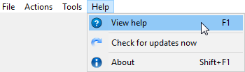
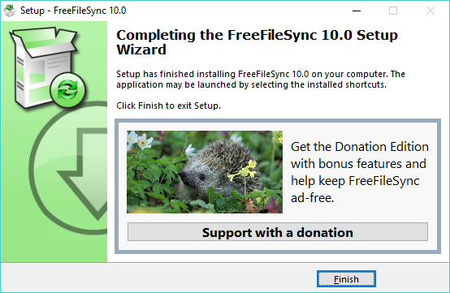
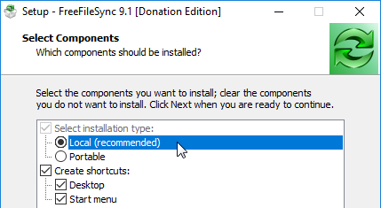
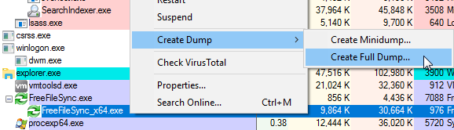
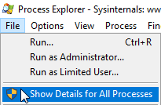
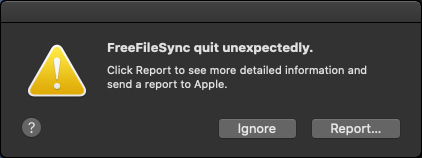
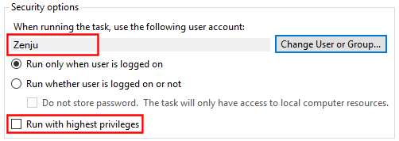
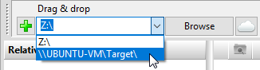
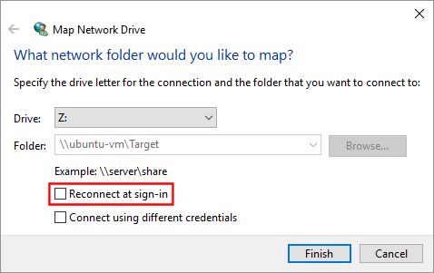
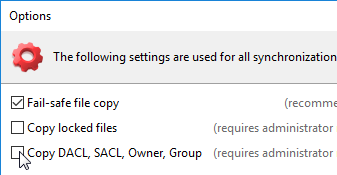

# FreeFileSync FAQ

A condensed summary of the official [FreeFileSync FAQ](https://freefilesync.org/faq.php), written for this repository. The official page is the authoritative and current version; each section links to its original answer. Images are copies from freefilesync.org.

- [General](#general)
- [Licensing](#licensing)
- [Installation](#installation)
- [Troubleshooting](#troubleshooting)

## General

### How do I use FreeFileSync? ([original](https://freefilesync.org/faq.php#usage))

The workflow has four steps: pick the left and right folders, run a comparison, choose the synchronization settings, and start the sync.

| 1. Choose folders | 2. Compare | 3. Sync settings | 4. Synchronize |
| --- | --- | --- | --- |
|  |  |  |  |

The [video tutorials](https://freefilesync.org/tutorials.php) walk through common scenarios step by step.

### Where are the advanced features documented? ([original](https://freefilesync.org/faq.php#manual))



In the [online manual](https://freefilesync.org/manual.php) (press F1 inside the app); see also [MANUAL.md](MANUAL.md) in this repository. An offline copy of the manual ships in the installation folder. The *Tips and Tricks* chapter is worth reading once the basics are familiar.

### What makes FreeFileSync stand out? ([original](https://freefilesync.org/faq.php#features))

The FAQ lists around 40 features. In short:

- free to use, with no ads in the installer or the app
- syncs local drives, network shares, MTP devices (phones, tablets, cameras),  Google Drive, FTP/FTPS and SFTP
- no artificial file count limit; multiple folder pairs; parallel comparison and copying of several files
- detects moved and renamed items and conflicts, propagates deletions, compares by content, supports case-sensitive sync
- versioning of deleted and overwritten files, fail-safe copying, folder locking for shared network folders, detailed error reports
- batch jobs,  email notifications, macros such as `%date%`/`%time%`, environment variables, and paths by volume label for USB drives
- copies locked files (Volume Shadow Copy), NTFS permissions, extended attributes and alternate data streams, HFS+ extended attributes and ACLs; configurable symlink/junction handling; paths longer than 260 characters
- include/exclude filters, a multi-file rename tool, a disk-usage tree view, portable and installed variants, full Unicode, DST handling on FAT, and a UI in 30+ languages

### Which operating systems are supported? ([original](https://freefilesync.org/faq.php#operating-systems))

|  Windows |  macOS |  Linux |
| --- | --- | --- |
| 11, 10, 8.1, 8, 7 | 10.12 Sierra, 10.13 High Sierra, 10.14 Mojave, 10.15 Catalina, 11 Big Sur, 12 Monterey, 13 Ventura, 14 Sonoma, 15 Sequoia, 26 Tahoe, 27 Golden Gate | All major distributions, e.g. Arch Linux, CentOS, Debian, Fedora, Manjaro, Mint, openSUSE, Ubuntu |

### Is there a limit on the number of files? ([original](https://freefilesync.org/faq.php#limitations))

No artificial limit. In practice memory is the constraint: roughly one million file pairs per GB of RAM.

## Licensing

### Can I redistribute the installer? ([original](https://freefilesync.org/faq.php#distribute))

Yes, under conditions: it must be free of charge and completely unmodified, and it may not be bundled into another archive, installer or third-party automated installation system. The Donation and Business editions may not be redistributed at all.

### Is it free for commercial use? ([original](https://freefilesync.org/faq.php#commercial))

No. The standard and Donation editions are for personal use by private individuals. Commercial use by individuals, and any use by businesses, organizations or government agencies, requires the Business Edition.

### What is the Donation Edition? ([original](https://freefilesync.org/faq.php#donation-edition))


A thank-you build for anyone who donates, with a few extras:  an auto-updater,  parallel file copy,  email notifications and  a portable ZIP version. The download link appears right after donating and is also emailed. It is meant for the donor and friends, not for uploading elsewhere.

### What is the Business Edition? ([original](https://freefilesync.org/faq.php#business))


The licensed edition for commercial and government use, bought per device on the website. It costs €20 per device, allows unlimited use, and includes one year of updates. It adds the auto-updater, parallel file copy, email notifications (guaranteed during the update period),  silent installation and  a tax invoice. Company-specific payment terms are not offered.

### How do the editions compare? ([original](https://freefilesync.org/faq.php#editions))

| Feature | Standard | Donation | Business |
| --- | :---: | :---: | :---: |
|  Sync without limits |  |  |  |
|  Auto-updater |  |  |  |
|  Parallel file copy |  |  |  |
|  Email notifications |  |  |  |
|  Portable version (Windows only) |  |  |  |
|  Silent installation |  |  |  |
|  Tax invoice |  |  |  |
|  Price | Free | You decide | €20 per device |

### How does reselling work? ([original](https://freefilesync.org/faq.php#reselling))

On the business purchase page, tick *Reseller* and enter the end customer as licensee. The reseller gets an invoice plus two links: a customer URL with the downloads, to forward to the customer, and a private reseller URL for later extensions or extra devices.

### Are refunds possible? ([original](https://freefilesync.org/faq.php#refunds))

Licenses are a digital product and generally not refundable once the download link has been issued; technical problems should go to support.

## Installation

### Does the installer still contain ads? ([original](https://freefilesync.org/faq.php#advertisement))

No. Versions before 10 showed a single ad during setup; since FreeFileSync 10 the project is funded by donations only.



### Do I have to uninstall an old version first? ([original](https://freefilesync.org/faq.php#uninstall))

No. Installing over an existing version updates it in place, and a later uninstall removes everything.

### Can I install silently? ([original](https://freefilesync.org/faq.php#silent-installation))

Only with the Business Edition installer:

```
FreeFileSync_<version>_[Business]_Windows_Setup.exe /silent [/dir="<install path>"] [/create_shortcuts=yes|no]
```

### How does the portable version work? ([original](https://freefilesync.org/faq.php#portable))



The Donation Edition can install to a USB stick or external drive. Local installation is still recommended: the portable variant loses some integration, such as managing configurations from the Explorer context menu or starting batch jobs with a couple of clicks.

### My antivirus or firewall flags FreeFileSync ([original](https://freefilesync.org/faq.php#virus))


These are false positives from heuristic or reputation-based detection, which tends to flag new or rarely downloaded software. Detection names containing terms like *gen*, *generic*, *heur*, *heuristic*, *reputation* or (McAfee) *artemis* indicate a heuristic hit, not a known threat. When unsure, check the file with a multi-engine scanner such as [VirusTotal](https://www.virustotal.com).

## Troubleshooting

### Where do I report bugs or request features? ([original](https://freefilesync.org/faq.php#feedback))


In the [FreeFileSync forum](https://freefilesync.org/forum/). Many problems have already been answered there, so searching first often helps.

### FreeFileSync crashed or hangs ([original](https://freefilesync.org/faq.php#crash))

- **Windows:** a mini dump is usually written automatically on a crash. For a hang, use [Process Explorer](https://learn.microsoft.com/sysinternals/downloads/process-explorer): right-click the FreeFileSync process and choose *Create Dump → Create Full Dump*. If that is denied, enable *File → Show Details for All Processes* to elevate. Zip the `.dmp` and send it to the developer, using a file hoster for large files.

   

- **macOS:** make sure `defaults read com.apple.CrashReporter DialogType` returns `crashreport`; if not, run `defaults write com.apple.CrashReporter DialogType crashreport` and restart. On the next crash, open *Report… → Show Details* and copy the details to the forum or developer.

  

- **Linux:** enable core dumps, e.g. `echo '/tmp/%e CrashDump %t.dmp' | sudo tee /proc/sys/kernel/core_pattern`, then `ulimit -S -c unlimited` in a terminal and start FreeFileSync from that same terminal. Reproduce the crash and send the compressed dump.

### How do I record a trace for file access errors? ([original](https://freefilesync.org/faq.php#trace))

- **Windows:** run [Process Monitor](https://learn.microsoft.com/sysinternals/downloads/procmon) with default filters, repeat the failing operation, and save the trace as `.pml`.
- **macOS:** `sudo dtruss -d <command> &> ~/Desktop/trace.txt`. This needs DTrace allowed via `csrutil enable --without dtrace` in Recovery mode.
- **Linux:** `strace <command> &> ~/Desktop/trace.txt`.

### Network shares aren't found when running from Task Scheduler ([original](https://freefilesync.org/faq.php#task-scheduler-network))

1. Confirm the share works when accessed manually in Explorer and FreeFileSync.
2. Make sure the scheduled task runs under the same user account you tested with.

   

3. Use UNC paths (`\\server\share`) instead of mapped drive letters. Mappings belong to a single user session, so other accounts can't see them. Even the same account can fail: a non-persistent mapping isn't visible to the separate elevated session that *Run with highest privileges* creates. FreeFileSync's folder drop-down can switch a mapped path to its UNC form.

    

### Explorer shows a different item count ([original](https://freefilesync.org/faq.php#explorer-mismatch))

Common causes:

- the default filter excludes system items such as `$Recycle.Bin`, `System Volume Information` and `thumbs.db`
- symlinks are skipped by default
- errors were ignored during the comparison
- Explorer can't count items with paths longer than 260 characters
- Explorer itself sometimes miscounts

Drill into subfolders in both tools to find the item that differs.

### "Cannot read/write permissions of …" errors ([original](https://freefilesync.org/faq.php#permissions-error))



Turn off permission copying in *Menu → Tools → Options*; it is rarely needed. If you really need DACL/SACL/owner/group preserved, run FreeFileSync as administrator.

### Files still differ after syncing ([original](https://freefilesync.org/faq.php#different-after-sync))

Some software writes hidden alternate data streams to newly created files right after FreeFileSync copies them, which bumps their modification time. Known examples are Comodo antivirus ("File Source Tracking") and Windows Search indexing of `.eml` files. Find the culprit with Process Monitor, then disable that behavior or replace the tool.

### I deleted files by accident ([original](https://freefilesync.org/faq.php#restore-files))

It depends on the deletion handling in the sync settings: with *Permanent*, try an undelete tool; with *Recycle bin*, check the bin; with *Versioning*, look in the configured versioning folder.

### No download link after donating ([original](https://freefilesync.org/faq.php#donation-edition-download))

The link is emailed automatically. Check the spam folder, and check the address registered with PayPal, which may differ from the one you looked at.
