# FreeFileSync manual (summary)

A condensed guide to the official [FreeFileSync user manual](https://freefilesync.org/manual.php?topic=all), written for this repository. The official manual is the authoritative and current version (also available offline in the installation folder and via F1 in the app); each section links to its original topic. Images are copies from freefilesync.org.

**Contents:** [Quick start](#quick-start) · [Command line](#command-line) · [Comparison settings](#comparison-settings) · [Daylight saving time](#daylight-saving-time-windows) · [Filters](#excluding-files-with-filters) · [Expert settings](#expert-settings) · [External applications](#external-applications) · [Macros](#macros) · [Performance](#performance) · [RealTimeSync](#realtimesync) · [RealTimeSync as a service](#realtimesync-as-a-service-windows) · [Scheduling batch jobs](#scheduling-batch-jobs) · [Scripting](#scripting) · [Synchronization settings](#synchronization-settings) · [SFTP and FTP](#sftp-and-ftp-setup) · [Tips and tricks](#tips-and-tricks) · [Variable drive letters](#variable-drive-letters) · [Versioning](#versioning) · [Volume Shadow Copy](#volume-shadow-copy-windows)


## Quick start

[Original topic](https://freefilesync.org/manual.php?topic=freefilesync)

Select a left and a right folder, click **Compare**, adjust the synchronization settings, then click **Synchronize**.

| 1. Choose folders | 2. Compare | 3. Sync settings | 4. Synchronize |
| --- | --- | --- | --- |
|  |  |  |  |

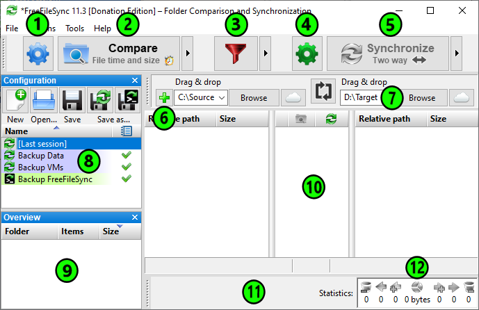

The main window gives access to:

- comparison settings and the Compare button
- include/exclude filters
- synchronization settings and the Synchronize button
- adding folder pairs and selecting the left/right folders
- saving and loading configurations
- the tree overview panel
- the sync preview
- category toggles for what the grid shows
- sync statistics

## Command line

[Original topic](https://freefilesync.org/manual.php?topic=command-line)

`FreeFileSync -h` (or `--help`) prints the syntax.

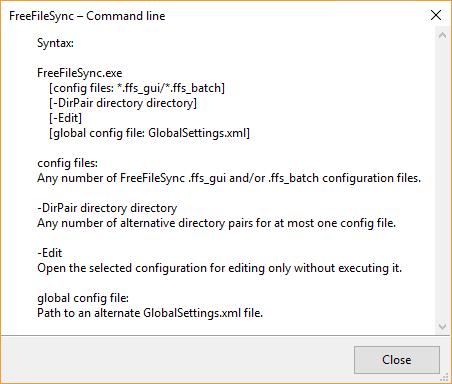

| Usage | Example |
| --- | --- |
| Run a batch job | `FreeFileSync "D:\Backup Projects.ffs_batch"` |
| Open a GUI config and start comparing (if all folders exist) | `FreeFileSync "D:\Manual Backup.ffs_gui"` |
| Override the folders of a config | `FreeFileSync "D:\Manual Backup.ffs_gui" -dirpair C:\NewSource D:\NewTarget` |
| Merge several configs into one multi-pair GUI session | `FreeFileSync "a.ffs_gui" "b.ffs_batch"` |
| Use another global settings file | `FreeFileSync "D:\Different GlobalSettings.xml"` |

A batch run writes its result as JSON to standard output (see [Scripting](#scripting)) and sets the exit code:

| Exit code | Meaning |
| --- | --- |
| 0 | success |
| 1 | completed with warnings |
| 2 | completed with errors |
| 3 | cancelled |

For unattended runs, make sure no dialog can block: enable **Auto-Close**, and set error handling to **Ignore errors** or **Cancel**.

## Comparison settings

[Original topic](https://freefilesync.org/manual.php?topic=comparison-settings)

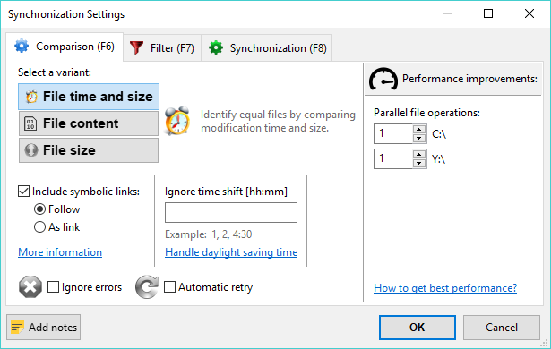

Files are matched by their path relative to the folder pair, then classified by the chosen comparison variant:

| Variant | Files are equal when | Use it for | Categories |
| --- | --- | --- | --- |
| **File time and size** | modification time and size match | normal backups (the usual choice) | left/right only, left/right newer, equal, conflict (same time, different size) |
| **File content** | content is bit-for-bit identical | consistency checks, or when times are unreliable (some phones, old FTP servers); the slowest variant | left/right only, equal, different content |
| **File size** | sizes match | when times are unreliable and content comparison is too slow (some MTP/FTP setups) | left/right only, equal, different size |

**Symbolic links** can be skipped (the default) or included in one of two ways. **Follow** treats a link as its target: folder links are traversed and the target is copied. **As link** copies the link object itself without traversing it. FreeFileSync treats file system symlinks, NTFS mount points and junctions, WSL symlinks and Google Drive shortcuts as links. On Windows, copying links requires administrator rights.

## Daylight saving time (Windows)

[Original topic](https://freefilesync.org/manual.php?topic=daylight-saving-time)

NTFS stores file times in UTC and FAT/exFAT in local time, so after a DST change or a time zone switch, files that were in sync can show up exactly one hour apart (typically USB stick vs. local disk). There are two fixes:

- In the comparison settings, add the time shift(s) to ignore: a single one-hour shift for DST, or the relevant offsets after a time zone change. The shift is an exact offset, not a tolerance.

  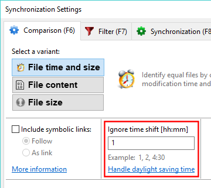

- Sync like with like, e.g. format the USB stick as NTFS too.

## Excluding files with filters

[Original topic](https://freefilesync.org/manual.php?topic=exclude-files)

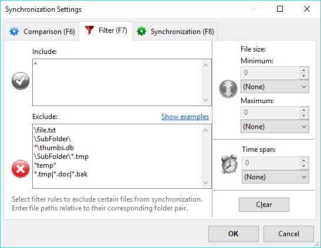

An item is synced only if it matches at least one include entry and no exclude entry. The rules:

- entries are paths relative to the folder pair, separated by `|` or new lines
- matching is case-insensitive, and `/` and `\` are interchangeable
- wildcards: `*` (zero or more characters), `?` (exactly one), `?*` (one or more)
- a trailing `:` matches files only; a trailing separator matches folders only
- matching a folder also matches everything inside it, so `SubFolder\` and `SubFolder\*` are the same

| Goal (pair `C:\Source ↔ D:\Target`) | Filter |
| --- | --- |
| one file | `\file.txt` |
| one folder | `\SubFolder\` |
| every `thumbs.db` | `*\thumbs.db` |
| names starting with `z` | `*\z*` |
| `*.tmp` in one folder | `\SubFolder\*.tmp` |
| anything with `temp` in its path | `*temp*` |
| several patterns | `*.tmp \| *.doc \| *.bak` |
| everything inside subfolders | `*\` |
| files only (leaves out empty folders) | `*:` |

For exceptions, use two folder pairs with the same paths and different local filters. For example, exclude `\SubFolder\` in one pair and include only `\SubFolder\*.txt` in the other. For quick one-off exclusions, right-click items in the main grid and exclude them from the context menu.

## Expert settings

[Original topic](https://freefilesync.org/manual.php?topic=expert-settings)

Some options exist only in `GlobalSettings.xml`, which is read at startup and written on exit, so edit it while FreeFileSync is closed. It lives in the installation folder for portable installs, otherwise in `%AppData%\FreeFileSync` (Windows), `~/.config/FreeFileSync` (Linux) or `~/Library/Application Support/FreeFileSync` (macOS).

| Setting | Default | Effect |
| --- | --- | --- |
| `FileTimeTolerance` | 2 seconds | time difference still treated as equal (FAT only stores 2-second precision) |
| `RunWithBackgroundPriority` | off | lowers FreeFileSync's I/O priority so other apps stay responsive, at the cost of speed |
| `LockDirectoriesDuringSync` | on | uses `sync.ffs_lock` files so only one FreeFileSync instance syncs a folder at a time (useful for shared network folders) |
| `VerifyCopiedFiles` | off | re-reads and compares each copied file; can double copy time and can't rule out corruption hidden by caches |

## External applications

[Original topic](https://freefilesync.org/manual.php?topic=external-applications)

Double-clicking a row opens the system file browser by default. Under *Menu → Tools → Options → Customize context menu* you can add or replace commands. The entries are reachable through the context menu and the number keys 0–9, and the first entry also runs on double-click.

Commands can use these macros:

| Macro | Value |
| --- | --- |
| `%item_path%` | full path of the item |
| `%local_path%` | like `%item_path%`, but SFTP/MTP files are first copied to a temporary local file |
| `%item_name%` | file or folder name |
| `%parent_path%` | parent folder |

Append `2` (e.g. `%local_path2%`) to refer to the item on the other side, or `s` (e.g. `%item_paths%`) to get all selected items separated by spaces. Some examples:

- **Diff tool:**
  - WinMerge: `"C:\Program Files (x86)\WinMerge\WinMergeU.exe" %local_path% %local_path2%`
  - macOS: `opendiff %local_path% %local_path2%`
  - Linux: `kompare %local_path% %local_path2%`
- **Reveal in Explorer:** `explorer.exe /select, %local_path% & exit 0`. The `exit 0` is there because Explorer doesn't return a success code.
- **Open a console in the folder:** `start cmd.exe /k cd /D %parent_path%`
- **Copy the path:** `echo %item_path%| clip`
- **Append to a list:** `echo %item_path% >> %csidl_Desktop%\file_list.txt`
- **Quick Look on macOS:** `qlmanage -p %local_path%`
- **Pass all selected files to a script:** `C:\my-script.cmd %local_paths%`

## Macros

[Original topic](https://freefilesync.org/manual.php?topic=macros)

Folder paths can contain `%…%` macros, which are expanded when a sync runs. The time macros are:

- `%Date%` (YYYY-MM-DD)
- `%Time%` (hhmmss)
- `%TimeStamp%` (YYYY-MM-DD hhmmss)
- `%Year%`, `%Month%`, `%MonthName%` (Jan–Dec), `%Day%`
- `%Hour%`, `%Min%`, `%Sec%`
- `%WeekDay%` (1–7; the week start depends on locale), `%WeekDayName%` (Mon–Sun), `%Week%` (calendar week)

Environment variables work as well. On Windows, for example, `%AppData%`, `%LocalAppData%`, `%ProgramData%`, `%ProgramFiles%`, `%UserProfile%`, `%UserName%`, `%ComputerName%`, `%Temp%` and `%WinDir%`. There are also special-folder macros such as `%csidl_Desktop%`, `%csidl_Documents%`, `%csidl_Pictures%`, `%csidl_Music%`, `%csidl_Videos%`, `%csidl_Downloads%`, `%csidl_StartMenu%` and `%csidl_Startup%`; most have a public variant, e.g. `%csidl_PublicDocuments%`.

A batch config can refer to a variable that a wrapper script sets, for example a target folder written as `%MyVar%`:

```bat
set MyVar=C:\Target
"C:\Program Files\FreeFileSync\FreeFileSync.exe" C:\SyncJob.ffs_batch
```

Call the executable directly: `start /wait` creates a new context that doesn't have the temporary variable.

## Performance

[Original topic](https://freefilesync.org/manual.php?topic=performance)

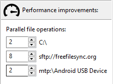

Parallel file operations help most when each operation has high latency (slow networks) or when each connection is throttled (FTP servers with per-connection limits). The number of parallel operations is set per device root in the comparison settings:

- **During comparison**, folders are grouped by device root and each group uses that root's setting. Take two pairs, `C:\Source ↔ D:\Target` and `C:\Source2 ↔ E:\Target`, with C: = 1, D: = 2 and E: = 3. Both C: folders share 1 operation, D: uses 2 and E: uses 3, for 6 parallel operations in total.
- **During sync**, each folder pair uses the higher of its two folders' values.

Parallel operations open several connections to a device, so watch connection limits on servers such as SFTP.

## RealTimeSync

[Original topic](https://freefilesync.org/manual.php?topic=realtimesync)


RealTimeSync runs a command line whenever a monitored folder changes, or when a folder becomes available (e.g. a USB stick is plugged in). The command is usually a FreeFileSync batch job. It gets change notifications from the OS rather than polling, and it waits for a configurable idle period without further changes before running the command.

To set it up, start RealTimeSync and either pick the folders by hand or open or drop an `.ffs_batch` file. In the second case it fills in the folders and the command for you. Then press **Start**.

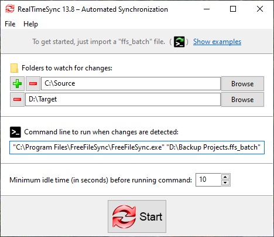

- The command must not block, so a batch job run this way shouldn't show dialogs (see [Command line](#command-line)).
- Passing an `.ffs_real` file starts monitoring immediately, which is handy for autostart.
- Passing an `.ffs_batch` file converts it to a default `.ffs_real` config, with a 10-second idle time.
- RealTimeSync doesn't depend on FreeFileSync. It can run any command, such as sending an email when a folder changes.

**USB stick example:** keep the `.ffs_batch` on the stick and point RealTimeSync at the stick by its volume label instead of a drive letter. The job then runs whenever the folder appears or changes.

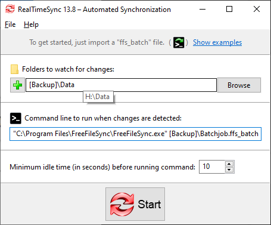

The command can read `%change_path%` and `%change_action%` (create/update/delete) for the last change, e.g. `echo %change_action% %change_path% >> %csidl_Desktop%\log.txt` on Windows, or `echo $change_action $change_path >> ~/Desktop/log.txt` on Linux/macOS. It has some limitations:

- only the first path is reported when several changes happen at once
- monitoring pauses while the command runs, so FreeFileSync's own writes don't retrigger it
- some network drivers never send change notifications

## RealTimeSync as a service (Windows)

[Original topic](https://freefilesync.org/manual.php?topic=rts-as-service)

The goal is to run `"C:\Program Files\FreeFileSync\RealTimeSync.exe" "D:\Backup Projects.ffs_real"` automatically:

- **At login:** create a shortcut with that command and put it in the startup folder. Type `shell:startup` in Explorer's address bar to open it.

  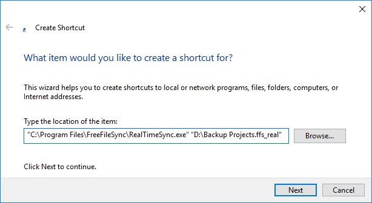 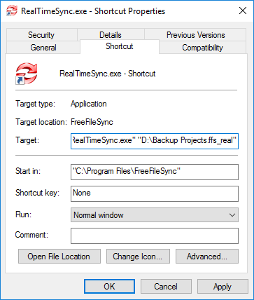

- **Regardless of who is logged in:** create a Task Scheduler task that runs at system startup under the SYSTEM account.

  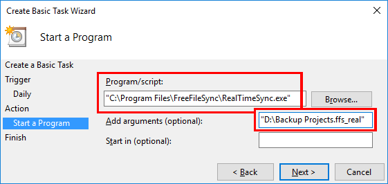

## Scheduling batch jobs

[Original topic](https://freefilesync.org/manual.php?topic=schedule-batch-jobs)

Save the configuration with *Menu → File → Save as a batch job…*. For unattended use, enable **Run minimized** and **Auto-Close**, and set errors to **Ignore** or **Cancel**. Otherwise a dialog nobody can close stalls the job, especially when it runs under another account. A minimized run can be brought up from the notification area icon.

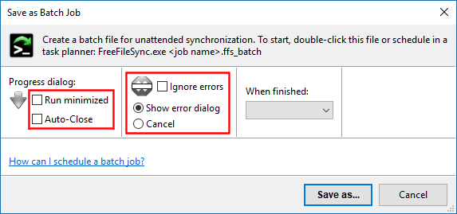

**Windows Task Scheduler** (`taskschd.msc`):

1. Create a basic task.
2. Set *Program/script* to `FreeFileSync.exe`, not the `.ffs_batch` file, which fails with error 0x800700C1.
3. Put the quoted `.ffs_batch` path in *Add arguments*.

Under a different account, `GlobalSettings.xml` is read from that account's profile; for SYSTEM that is `C:\Windows\System32\config\systemprofile\AppData\Roaming\FreeFileSync`. Pass a settings file on the command line to override it.

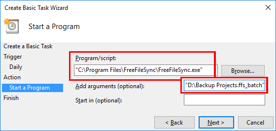

**macOS Automator and Calendar:**

1. In Automator, create a *Calendar Alarm*.
2. Drop the `.ffs_batch` file onto the workflow.
3. Add *Files & Folders → Open Finder Items*.
4. Save. Calendar opens with the job scheduled for today, so set the time and recurrence there.

| | | |
| --- | --- | --- |
| 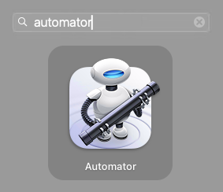 | 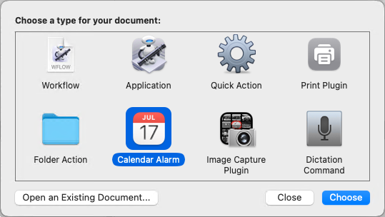 | 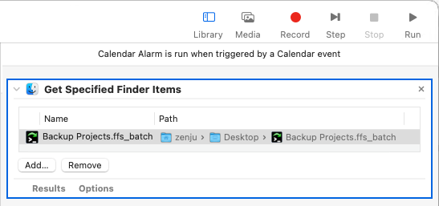 |
| 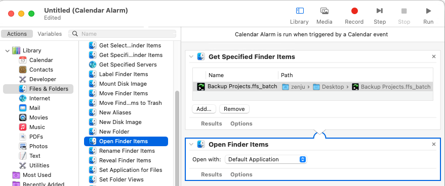 |  | 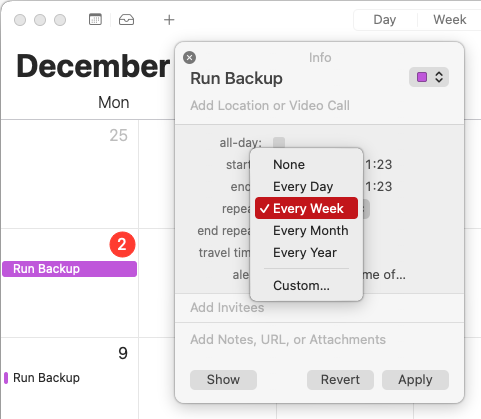 |

**Linux/macOS cron:** run `crontab -e` (or `EDITOR=nano crontab -e`) and add a line with the schedule followed by the executable and the batch file. On macOS the executable is inside the app bundle: `/Applications/FreeFileSync.app/Contents/MacOS/FreeFileSync`.

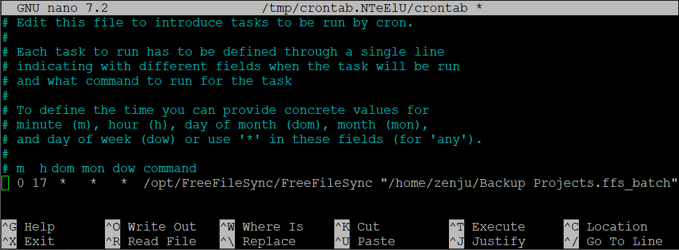

```cron
# minute hour day-of-month month day-of-week  command
0 * * * *          /opt/FreeFileSync/FreeFileSync "/home/me/Backup.ffs_batch"   # hourly
0 17 * * *         /opt/FreeFileSync/FreeFileSync "/home/me/Backup.ffs_batch"   # daily at 17:00
*/10 9-17 * * mon,fri  /opt/FreeFileSync/FreeFileSync "/home/me/Backup.ffs_batch"   # every 10 min, 9–17, Mon and Fri
@reboot sleep 60; /opt/FreeFileSync/FreeFileSync "/home/me/Backup.ffs_batch"       # 60 s after boot
```

If nothing seems to happen, append `>> ~/cron_log.txt 2>&1` to the command to capture its output and errors.

## Scripting

[Original topic](https://freefilesync.org/manual.php?topic=scripting)

Batch runs print a JSON summary to standard output. On Windows, pipe the output (e.g. `| more`) to see it, because FreeFileSync is a GUI app. The fields are:

- `syncResult`: `success`, `warning`, `error` or `cancelled`
- `startTime` and `totalTimeSec`
- `errors` and `warnings`
- `totalItems`, `totalBytes`, `processedItems` and `processedBytes`
- `logFile`

For example, to delete the log when nothing was synced, in PowerShell:

```powershell
$data = & "C:\Program Files\FreeFileSync\FreeFileSync.exe" "D:\Backup Projects.ffs_batch" | ConvertFrom-Json
if ($data.syncResult -eq "success" -and $data.totalItems -eq 0) { Remove-Item $data.logFile }
```

The same in Python:

```python
import json, os, subprocess
out = subprocess.run(["/opt/FreeFileSync/FreeFileSync", "/home/me/Backup.ffs_batch"], stdout=subprocess.PIPE, text=True).stdout
data = json.loads(out)
if data["syncResult"] == "success" and data["totalItems"] == 0:
    os.remove(data["logFile"])
```

## Synchronization settings

[Original topic](https://freefilesync.org/manual.php?topic=synchronization-settings)

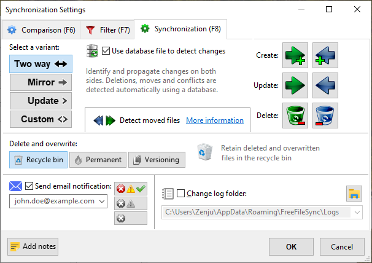

| Variant | Behavior |
| --- | --- |
| **Two way** | Creates, updates and deletes flow in both directions. After the first run, `sync.ffs_db` database files record the last state so later runs can tell what changed. |
| **Mirror** | Left is the source and right the target; the target is made an exact copy, including deletions. |
| **Update** | Copies new and changed files to the target but never deletes there. Files deleted from the target aren't copied again. |
| **Custom** | Set your own rules, either per comparison category (left/right only, left/right newer) or per detected change (create/update/delete) when *Use database file to detect changes* is on. |

**Moved files** are detected and moved on the target instead of being copied and deleted, provided *Use database file to detect changes* is on and the file system has stable file IDs. This works from the second sync onward. It isn't available on FAT in some cases or over SFTP; there FreeFileSync falls back to copy and delete.

## SFTP and FTP setup

[Original topic](https://freefilesync.org/manual.php?topic=ftp-setup)

Use the cloud button next to a folder field and enter the server login.

 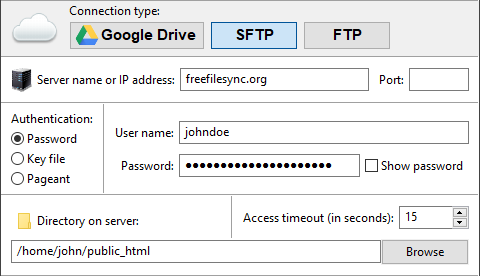

If the server stamps uploads with the current time, compare by file size, or use two-way sync so the newer server copies flow back.

**Speeding up SFTP:** by default FreeFileSync uses one connection with one channel. Folder reading speeds up by roughly N × M with N connections of M channels each; 10 connections × 2 channels can be up to 20× faster.

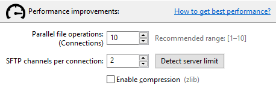

- Setting up connections costs time, and more than channels do, so keep them modest for small folders.
- Servers limit connections per user and may stop responding if you open too many.
- Extra channels are only used while reading folders, not while syncing.
- Compression helps on slow links with compressible data, but can slow fast links or already-compressed data.

Start low and experiment, and restart FreeFileSync between tests, since it reuses open connections.

## Tips and tricks

[Original topic](https://freefilesync.org/manual.php?topic=tips-and-tricks)

| Tip | |
| --- | --- |
| Change a setting in one gesture: hold the right mouse button on the comparison, filter or sync button and release over the choice | 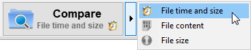 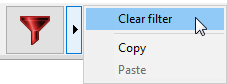 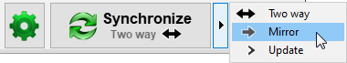 |
| Select several configurations at once (Ctrl-click to refine) | 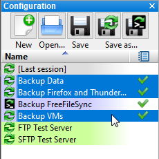 |
| Double-click a configuration to compare right away | 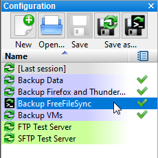 |
| Synchronize only the selected rows | 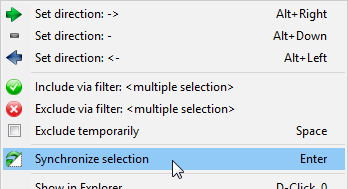 |
| Add more folder pairs, each with its own settings | 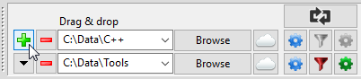 |
| Synchronize without comparing first |  |
| Drag a window by any empty area |  |
| Edit a batch config from Explorer's context menu | 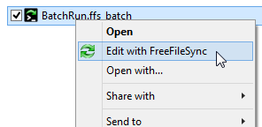 |
| Drop two folders at once to fill a folder pair | 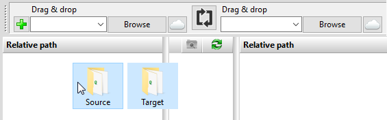 |
| Copy the selected files to another folder (e.g. to save a "diff") | 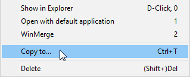 |
| Refer to a drive by volume label instead of letter | 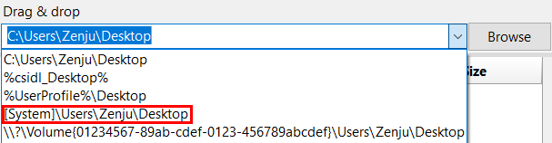 |
| Turn on thumbnails from the column header menu | 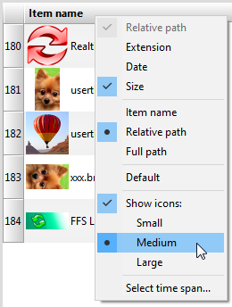 |
| Save the current view filter as the default |  |
| Remove local settings from a folder pair | 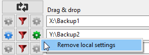 |
| Remove stale entries from the folder drop-down (hover + Delete) | 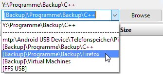 |
| Include only a time span via the date column menu | 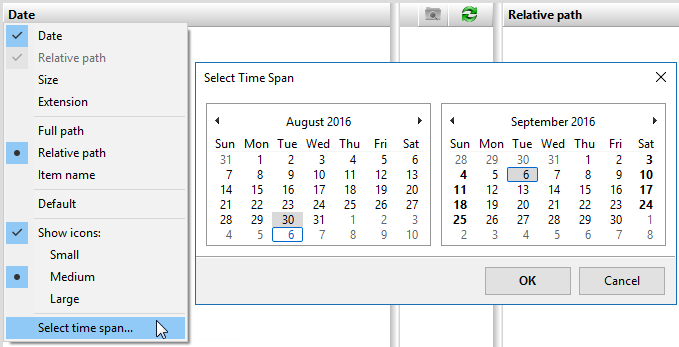 |
| Double-click a comparison or sync variant to confirm the dialog | 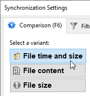 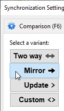 |
| Rename several files at once (context menu or F2) | 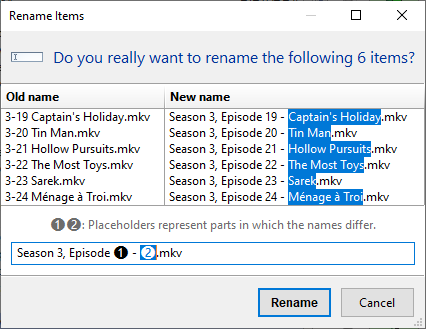 |

## Variable drive letters

[Original topic](https://freefilesync.org/manual.php?topic=variable-drive-letters)

Removable drives often get a different letter each time they're plugged in. There are two ways around this:

- **Volume label:** `[Backup-Disk]\folder` instead of `E:\folder`. Rename a drive's label from Explorer.
- **Volume GUID:** `\\?\Volume{01234567-89ab-cdef-0123-456789abcdef}\folder`. This never changes; `mountvol` lists the GUIDs.

You don't have to type either form: pick the alternative path from the folder drop-down.


## Versioning

[Original topic](https://freefilesync.org/manual.php?topic=versioning)

The recycle bin only works for local drives and gives little control, so **Versioning** (in the deletion handling of the sync settings) moves deleted and overwritten files to a folder you choose.

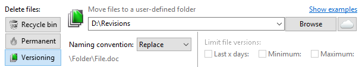

| Naming convention | Result for `Folder\File.txt` in `D:\Revisions` |
| --- | --- |
| **Replace**: keep only the latest version | `D:\Revisions\Folder\File.txt` |
| **Time stamp [File]**: time stamp appended to each file | `D:\Revisions\Folder\File.txt 2020-12-11 111111.txt`, … |
| **Time stamp [Folder]**: one time-stamped folder per run, original names kept, so a run is easy to undo | `D:\Revisions\2020-12-11 111111\Folder\File.txt`, … |
| **Replace** with a macro in the folder path, e.g. `D:\Revisions\%date%`: one version per day | `D:\Revisions\2020-12-11\Folder\File.txt`, … |

## Volume Shadow Copy (Windows)

[Original topic](https://freefilesync.org/manual.php?topic=volume-shadow-copy)

To copy files that are locked or in use, enable *Menu → Tools → Options → Copy locked files*. FreeFileSync then snapshots the source volume through the Volume Shadow Copy Service and reads locked files from the snapshot. This requires administrator rights.
