# FreeFileSync source history

An unofficial git mirror of the [FreeFileSync](https://freefilesync.org) source code, rebuilt from the source archives published on the [release archive](https://freefilesync.org/archive.php) and [download](https://freefilesync.org/download.php) pages. Upstream publishes no public repository, only a source zip per release; this repository turns those zips into a browsable history with one commit per release, from FreeFileSync 1.0 (Aug 2008) to the current release. Every version is also published as a [GitHub release](https://github.com/cuong-tran/FreeFileSync/releases) (tag `v<version>`) with the official prebuilt Windows, macOS and Linux downloads attached; the source of each release is its tagged commit.

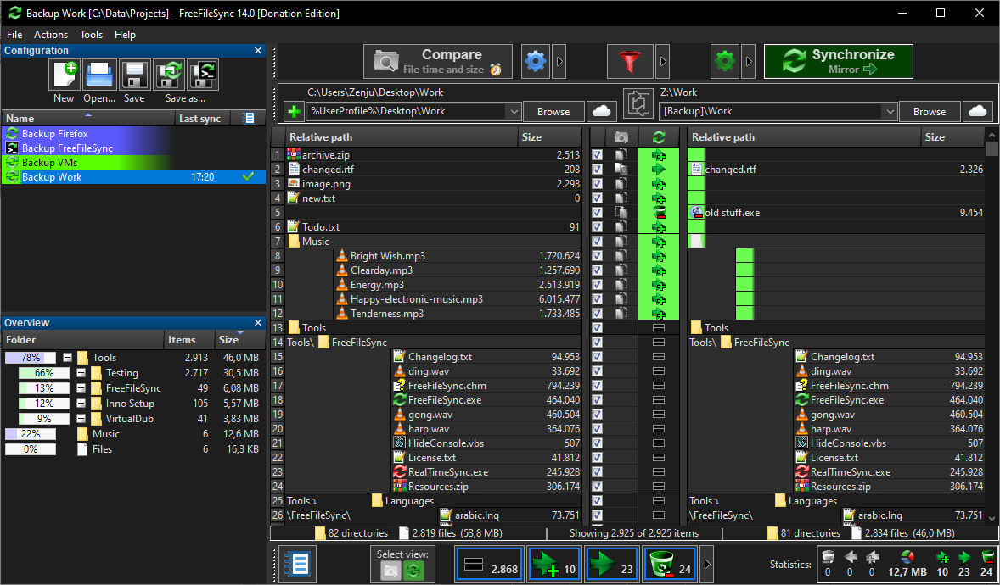

## About FreeFileSync

FreeFileSync, by Zenju, is open source software for comparing and synchronizing folders, and for creating and maintaining backup copies of your files. Rather than copying everything on every run, it works out how a source and a target folder differ and transfers only the data needed to bring them in line. It runs on Windows, macOS and Linux, and is written in C++ on top of wxWidgets. See the [project homepage](https://freefilesync.org) for downloads and tutorials, and [MANUAL.md](MANUAL.md) and [FAQ.md](FAQ.md) in this repository for a summary of the manual and FAQ.

| Synchronization progress | Synchronization settings |
| --- | --- |
| 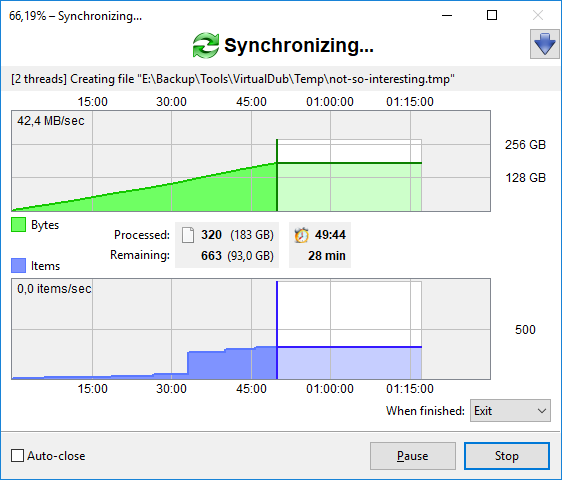 | 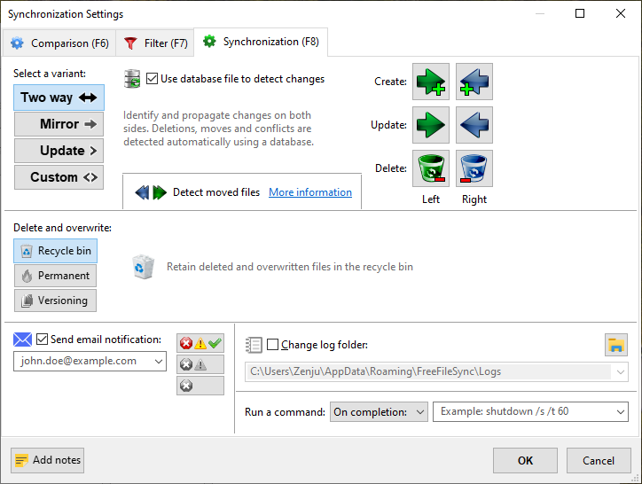 |

## Screenshots

From the [screenshots page](https://freefilesync.org/screenshots.php):

| | | |
| --- | --- | --- |
|  Windows, dark mode | 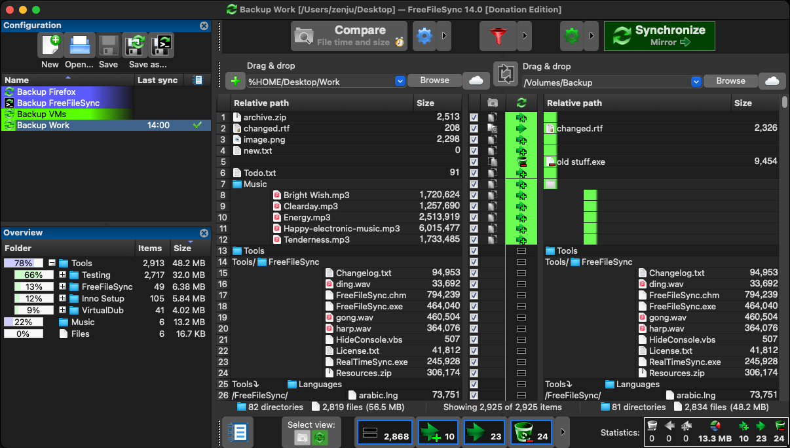 macOS, dark mode | 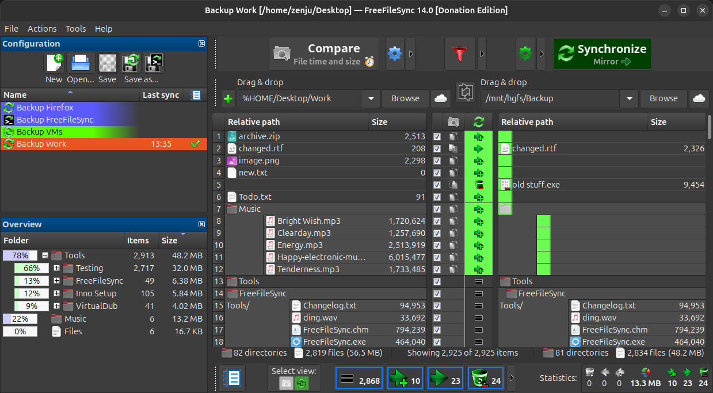 Ubuntu, Adwaita-Dark theme |
| 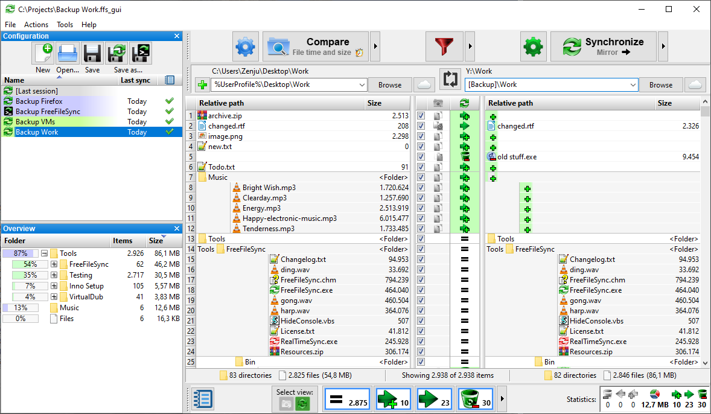 Windows | 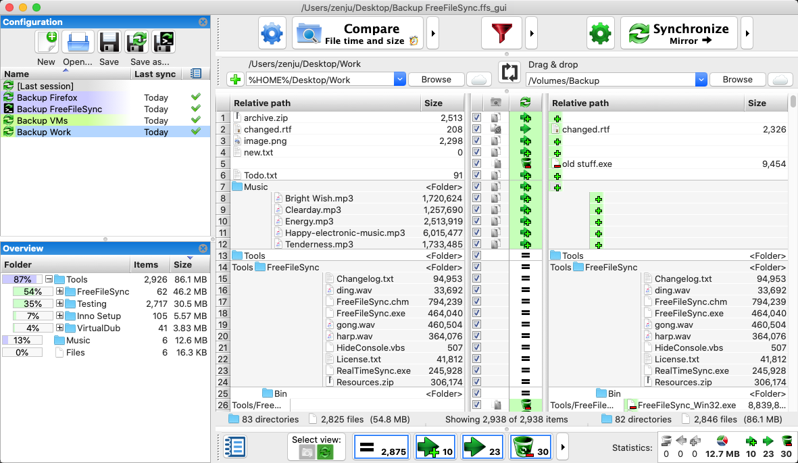 macOS | 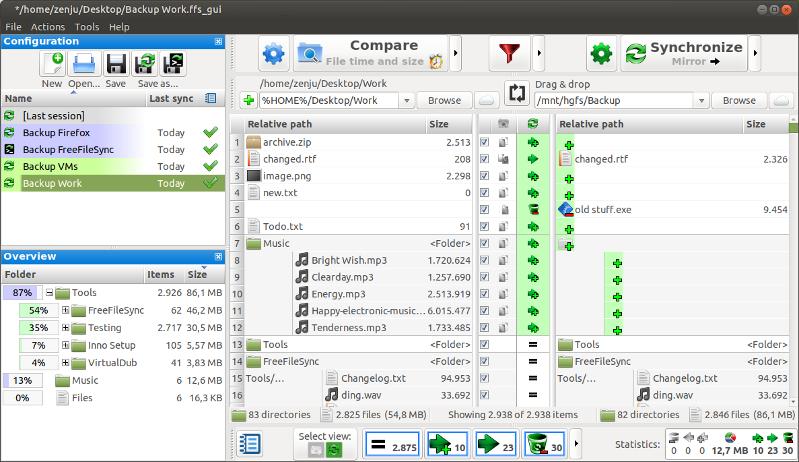 Ubuntu (GNOME) |
| 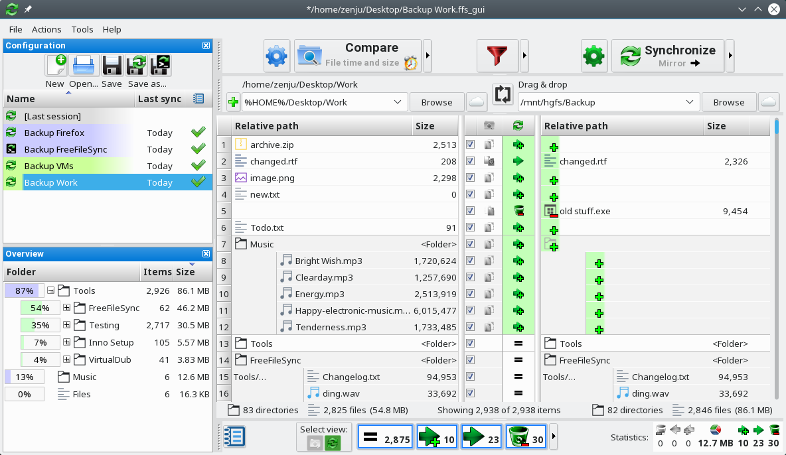 openSUSE (KDE) | 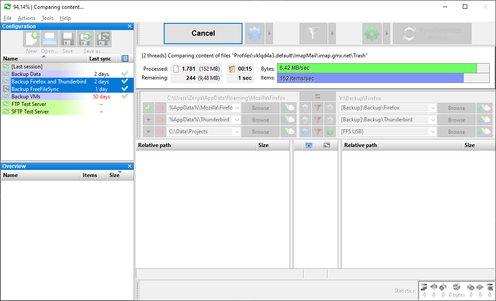 Binary comparison | 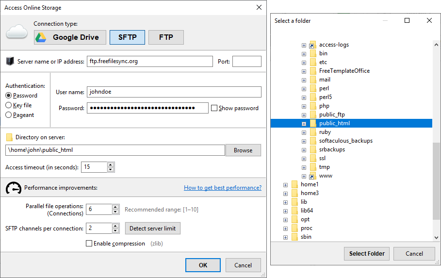 Online storage: Google Drive, SFTP, FTP |
| 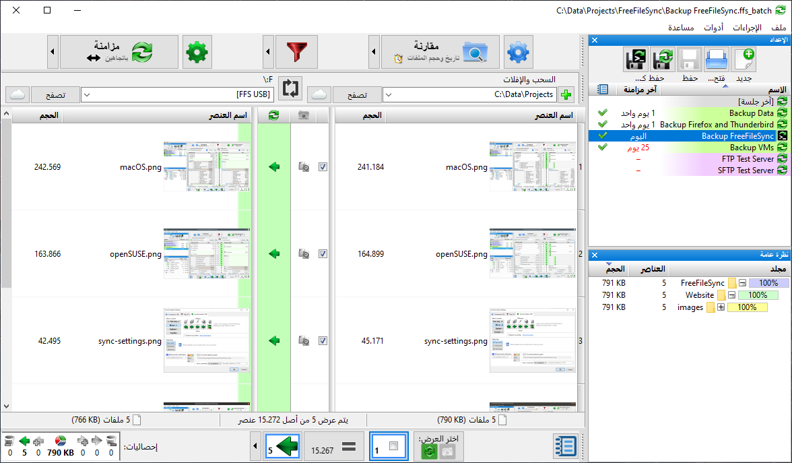 Flexible layout: custom panels, right-to-left, icon sizes |  Synchronization progress | 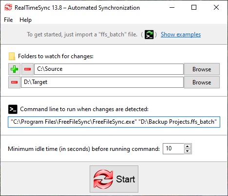 Triggering syncs with RealTimeSync |
| 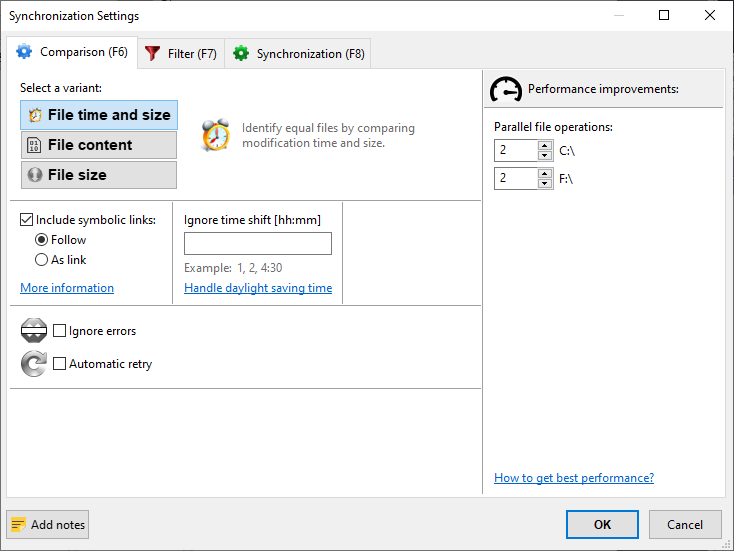 Comparison settings | 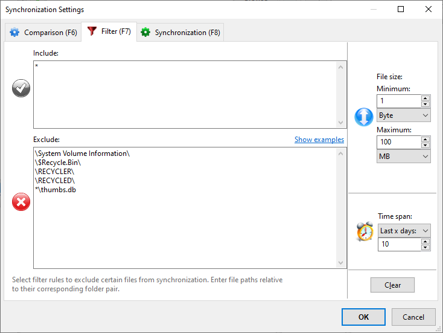 Include/exclude filter |  Synchronization settings |
| 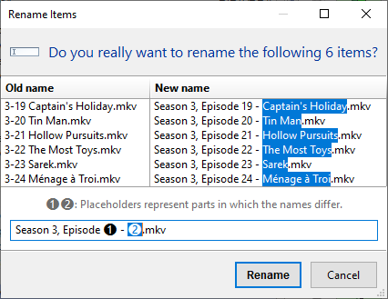 Renaming multiple files | | |

## Key features

A summary of the feature list in the [FreeFileSync FAQ](https://freefilesync.org/faq.php#features):

- **Free, no ads:** free to download and use (donations welcome), with no advertising in the installer or the app.
- **Many storage targets:** local drives, network shares, MTP devices (Android phones, iPhones, tablets, cameras), Google Drive, FTP/FTPS and SFTP.
- **Smart comparison and sync:** compare by content as well as by time and size, detect moved and renamed files, detect conflicts and propagate deletions, case-sensitive sync, and an optimal operation order that avoids running out of disk space.
- **Safety:** fail-safe file copying that prevents corrupted targets, versioning that keeps a history of deleted and overwritten files, folder locking for several users sharing a network folder, and detailed error reporting.
- **Scale and speed:** no artificial limit on the number of files, multiple folder pairs per job, parallel comparison and sync of several files, native 64-bit builds and a heavily optimized runtime.
- **Automation:** batch jobs, email notifications with the results, and macros (`%date%`, `%time%`, …), environment variables and volume-label paths for recurring backups to drives whose letter changes.
- **Platform details:** copying of locked files through Volume Shadow Copy, NTFS permissions, extended attributes and alternate data streams, HFS+ extended attributes and ACLs, configurable handling of symlinks, junctions and WSL symlinks, long paths over 260 characters, full Unicode, and handling of daylight saving time shifts on FAT/FAT32.
- **Tools and UI:** include/exclude filters, a multi-file rename tool, a tree view of disk space usage, portable and installed variants, and a user interface translated into more than 30 languages.

## Supported operating systems

Per the [FAQ](https://freefilesync.org/faq.php#features), FreeFileSync runs natively on:

| Windows | macOS | Linux |
| --- | --- | --- |
| Windows 11, 10, 8.1, 8 and 7 | macOS 10.12 Sierra through macOS 27 Golden Gate | All major distributions, including Arch Linux, CentOS, Debian, Fedora, Manjaro, Mint, openSUSE and Ubuntu |

## Builds from this repository

The official binaries come from freefilesync.org. This repository's CI builds its own from the sources (CI build products, not releases):

- **Linux**: a `.deb` and a portable tar.gz for x86_64 and aarch64 (`Linux build` workflow).
- **macOS** (being ported, milestone M3 of [docs/PORTING_PLAN.md](docs/PORTING_PLAN.md)): a disk image per architecture, `FreeFileSync-<version>-macos-arm64.dmg` (Apple silicon) and `-x86_64.dmg` (Intel), with `FreeFileSync.app` and `RealTimeSync.app` for macOS 13.3 or later: open it and drag both apps onto the *Applications* link (`macOS build` workflow; the same apps also as `.zip`). They are signed ad hoc, not by an Apple Developer ID, and not notarized, so macOS refuses to open them at first ("cannot be opened because the developer cannot be verified" or "is damaged"). To open one anyway: right-click the app in Finder, choose *Open* and confirm (on macOS 15 and later: try to open it once, then *System Settings → Privacy & Security → Open Anyway*), or remove the quarantine flag of the copied apps in Terminal with `xattr -dr com.apple.quarantine /Applications/FreeFileSync.app /Applications/RealTimeSync.app`. On drives without native extended attributes (FAT, exFAT, many network shares) macOS keeps an item's attributes in a hidden file `._<name>` next to it, and adds one for each file and folder an app creates there (macOS tags them with `com.apple.provenance`); FreeFileSync does not list such a `._<name>` when `<name>` exists next to it, as Finder does, so a file you named `._<name>` yourself next to `<name>` is not synchronized either.
- **Windows**: not yet (milestone M4).

## Crash reporting

Builds from these sources contain no crash reporting unless they are made with `FFS_SENTRY=1` (see [CONTRIBUTING.md](CONTRIBUTING.md#crash-reporting)); a default `make` has no reporting code at all. The Linux packages and the Mac apps built by this repository's CI use [Sentry](https://sentry.io) once the repository owner has set up the `SENTRY_DSN` secret.

In such a build:

- **What is sent**: when FreeFileSync or RealTimeSync crashes, a crash dump (the state of the program at the moment of the crash: the call stacks, the threads' stack memory, the CPU registers and the list of loaded program files with their paths), the program version, the operating system version and the name of the app. Unexpected internal errors (bugs, not errors such as "cannot open file") are sent as a message. Nothing else: no sync logs, no file lists, no settings, no user or computer name.
- **Paths are removed** from messages and breadcrumbs before they leave the machine (anything that looks like a path, an `sftp://`/`ftp://`/`gdrive:`/`mtp:`/`zip:` phrase or a URL becomes `<path>`; user and computer name become `<redacted>`). A crash dump can't be cleaned on the machine: the paths of the loaded program files (e.g. `/opt/FreeFileSync/Bin/FreeFileSync_x86_64` or a folder in your home) are part of it, and stack memory may hold fragments of what the program was working on when it crashed.
- **Nothing is sent before you answer**: the first start of FreeFileSync shows a notice saying what is sent, with a checkbox to turn reporting off (checked by default). Until it is answered, reports are only kept on disk, also by batch jobs and RealTimeSync; they are sent after the answer "send" and deleted after "don't send".
- **Turning it off**: uncheck *Send crash reports* in *Tools → Options* (stored as `<CrashReports Enabled="false"/>` in `GlobalSettings.xml`, which RealTimeSync honors too), or start the apps with the environment variable `FFS_NO_CRASH_REPORT=1`. Either way nothing is uploaded: with the setting off no crash dump is written, reports kept from before are deleted, and running FreeFileSync and RealTimeSync processes follow the change within seconds; with `FFS_NO_CRASH_REPORT=1` the reporter isn't started at all. The setting changes only when you change it (the checkbox starts unticked as long as you haven't answered the notice).

## Documentation

- [MANUAL.md](MANUAL.md): summary of the user manual (command line, filters, macros, RealTimeSync, scheduling, versioning, …)
- [FAQ.md](FAQ.md): summary of the FAQ (editions and licensing, installation, troubleshooting)
- [CONTRIBUTING.md](CONTRIBUTING.md): branch layout, importing new releases, source layout, building

## License

The code is FreeFileSync's, distributed under the GNU General Public License v3; see `License.txt` for the full terms, including third-party licenses. Note the upstream terms on private vs. commercial use of the prebuilt editions in the same file. The screenshots and documentation images in `docs/images/` are copies from freefilesync.org, and FAQ.md and MANUAL.md are summaries of its FAQ and manual; the official pages remain the authoritative versions. This repository only adds the import tooling and these docs.
